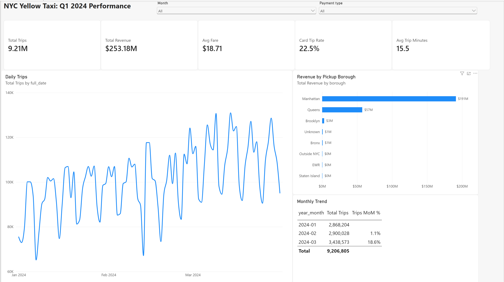
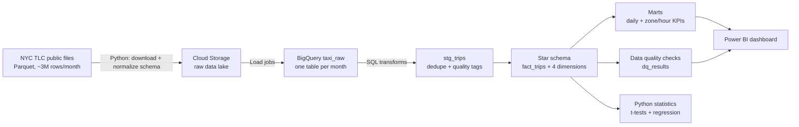
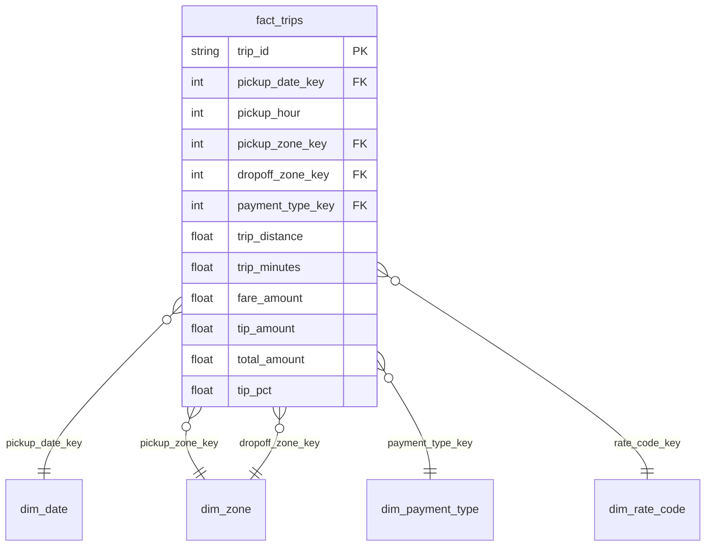
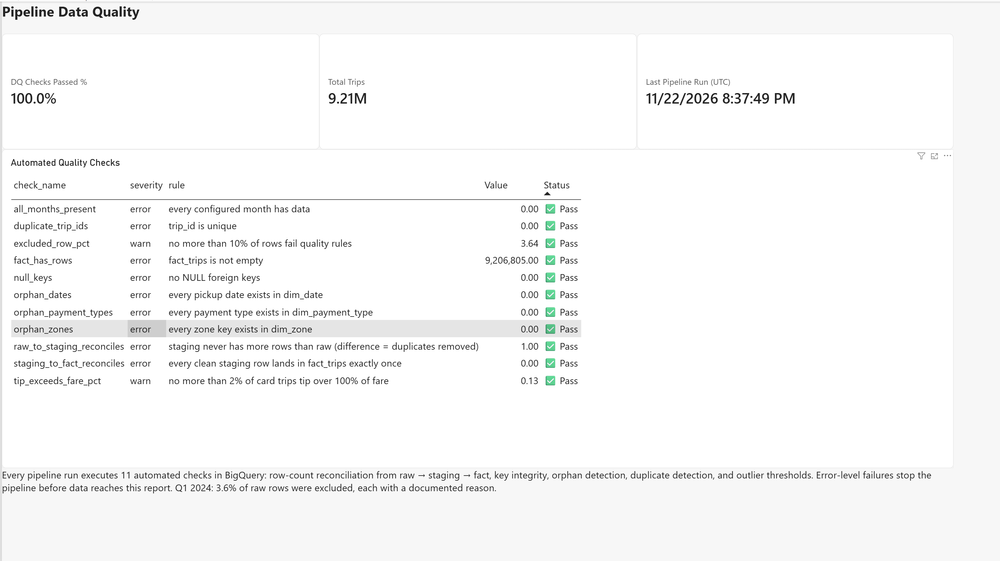

# NYC Taxi Cloud Analytics Pipeline

An end-to-end **ELT pipeline on Google Cloud** that loads millions of NYC Yellow Taxi
trips into a **BigQuery star-schema data warehouse**, runs **automated data quality
checks**, tests hypotheses about rider tipping with **statistical analysis**, and serves a
**Power BI** dashboard.

**Stack:** Python (pandas, SciPy, statsmodels) · Google Cloud (BigQuery, SQL) · Power BI (DAX)



---

## Architecture



## Data model



`fact_trips` is clustered by pickup date, zone and payment type, so typical dashboard
queries read only the blocks they need. It is deliberately *not* partitioned: the
BigQuery sandbox deletes partitions older than 60 days, which would wipe out this
historical data. On a billed project, monthly partitioning would be the next step.

## Design decisions

| Decision | Why |
|---|---|
| **ELT, not ETL** | Python only normalizes schema; all business logic is version-controlled SQL running inside BigQuery, which scales without extra infrastructure. |
| **Schema normalization on ingest** | The TLC renames and retypes columns between years (`Airport_fee` vs `airport_fee`, float vs int). Normalizing first keeps monthly tables compatible. |
| **One raw table per month** | Reloading a month replaces only that month (idempotent), with no DML needed. |
| **Tag bad rows, don't silently drop them** | Each staging row gets a `dq_issue` reason, so excluded data is fully accounted for and reported. |
| **Bytes-billed guardrail** | Every query has a hard scan limit (`MAX_BYTES_BILLED`), so a bad query fails instead of costing money. |
| **Effect sizes, not just p-values** | With millions of rows nearly everything is "significant". Cohen's d shows whether a difference actually matters. |

## Results

Run on January–March 2024. Full outputs are in [`reports/`](reports/).

- **Volume:** 9.55M raw trips loaded → **9.21M clean trips** in the star schema
- **Data quality:** all 9 error-level checks pass; **3.64%** of rows excluded by 8 rules,
  each with a recorded reason (top issues: zero distance 2.23%, negative amounts / refunds 1.32%)
- **Weekend effect is real but negligible:** weekend riders tip 0.79 pts less (p < 0.001),
  but Cohen's d = 0.07. Statistically significant, not practically meaningful.
- **Airport trips reverse once you control for trip length:** on average they tip 3.8 pts
  *less*, but holding distance and duration constant they tip **6.8 pts more**. The raw
  gap comes from airport trips being long, and tip % falls as trips get longer.
- **Location matters most:** compared with Manhattan pickups, tips are 13.6 pts lower for
  Bronx pickups and 10.2 pts lower for Brooklyn (regression, n = 717,661, robust SEs)
- **Weekday evening rush tips highest** (+2.1 pts vs midday). See `reports/tip_pct_by_hour.png`.
- **Dashboard:** 4-page Power BI report (Executive Overview, When People Ride, Where People
  Ride, Data Quality) on the star schema, with 11 DAX measures including time intelligence
  (month-over-month) and a role-playing zone dimension (`USERELATIONSHIP` for dropoffs)

## Dashboard

**When people ride:** demand by day and hour, and how tipping changes through the day


**Where people ride:** top pickup and dropoff zones, and airport vs non-airport trips


**Data quality:** results of the latest pipeline run's automated checks



---

## Run it yourself

### 1. One-time Google Cloud setup

1. Create a project at <https://console.cloud.google.com> and note its **project ID**.
2. Enable the **BigQuery API** (and **Cloud Storage** if you'll use a bucket).
3. Install the [Google Cloud CLI](https://cloud.google.com/sdk/docs/install), then sign in locally:
   ```
   gcloud auth application-default login
   ```
4. *(Optional)* Create a bucket for the raw data lake:
   ```
   gcloud storage buckets create gs://YOUR-UNIQUE-BUCKET --location=US
   ```
   On the free **BigQuery sandbox** (no billing account), skip the bucket and leave
   `GCS_BUCKET` empty. Files then load straight into BigQuery. Sandbox tables expire after 60 days.

### 2. Install and configure

```
python -m venv .venv
.venv\Scripts\activate          # macOS/Linux: source .venv/bin/activate
pip install -r requirements.txt
copy .env.example .env          # macOS/Linux: cp .env.example .env
```

Edit `.env` and set `GCP_PROJECT_ID` (and `GCS_BUCKET` if you made one).

### 3. Run

```
pytest -q                       # offline tests, no cloud needed
python run_pipeline.py          # extract/load -> transform -> data quality -> analysis
```

Or run one step at a time: `python run_pipeline.py --steps transform dq`

### 4. Dashboard

Follow [docs/powerbi_guide.md](docs/powerbi_guide.md).

## Project layout

```
pipeline/   extract_load.py   download, normalize, Cloud Storage, BigQuery load
            transform.py      runs sql/ files in order
            data_quality.py   11 automated checks -> dq_results table
analysis/   stats_analysis.py hypothesis tests + regression -> reports/
sql/        01 staging · 02-04 dimensions · 05 fact · 06 marts
tests/      offline unit tests
docs/       Power BI build guide
```

## Next steps

- Schedule the pipeline with **Cloud Composer (Airflow)**, using one task per step.
- Move transforms to **dbt** for lineage graphs and built-in tests.
- Stream new data with **Dataflow** instead of monthly batch loads.
