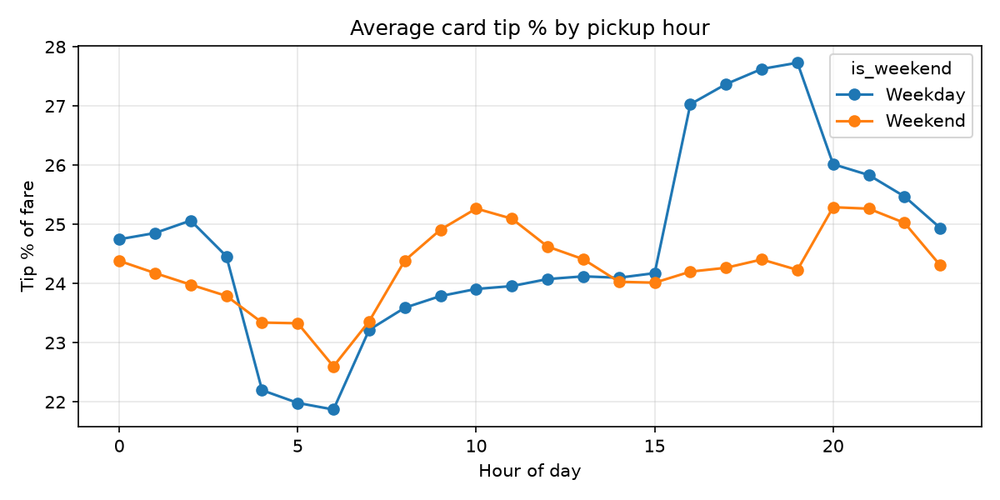
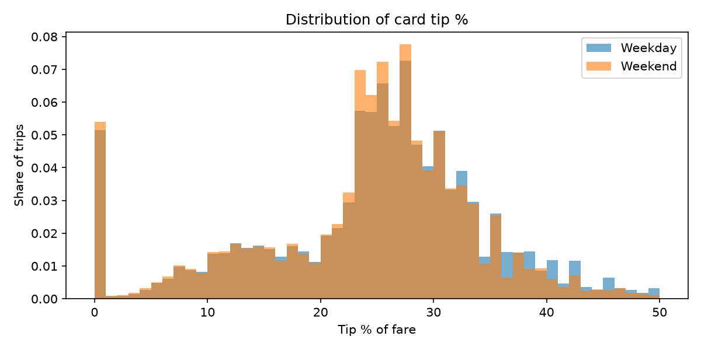

# Statistical analysis: what drives card tipping?

Sample: **717,661 card-paid trips** (deterministic hash sample of fact_trips).
Tip % = tip ÷ fare. Cash trips are excluded because the TLC doesn't record cash tips.

### H1: Weekend vs weekday

| Group | Trips | Mean tip % |
|---|---|---|
| Weekend | 196,681 | 24.46% |
| Weekday | 520,980 | 25.26% |

- Difference: **-0.79 percentage points**
- Welch's t-test p = < 0.001; Mann-Whitney U p = < 0.001
- Effect size (Cohen's d) = -0.073 → **negligible**

### H2: Airport vs non-airport

| Group | Trips | Mean tip % |
|---|---|---|
| Airport | 69,114 | 21.64% |
| Non-airport | 648,547 | 25.40% |

- Difference: **-3.76 percentage points**
- Welch's t-test p = < 0.001; Mann-Whitney U p = < 0.001
- Effect size (Cohen's d) = -0.349 → **small**

### M1: OLS regression of tip % (percentage points)

R² = 0.141, n = 717,661, heteroskedasticity-robust (HC3) standard errors.
Baselines: midday pickup, Manhattan.

| Term | Coefficient (pts) | 95% CI | p |
|---|---|---|---|
| Intercept | +29.432 | [+29.365, +29.500] | < 0.001 |
| C(hour_bucket, Treatment('midday'))[T.evening_rush] | +2.135 | [+2.075, +2.196] | < 0.001 |
| C(hour_bucket, Treatment('midday'))[T.late_night] | -0.461 | [-0.571, -0.352] | < 0.001 |
| C(hour_bucket, Treatment('midday'))[T.morning_rush] | -1.028 | [-1.104, -0.952] | < 0.001 |
| C(hour_bucket, Treatment('midday'))[T.night] | +0.560 | [+0.495, +0.626] | < 0.001 |
| C(pickup_borough, Treatment('Manhattan'))[T.Bronx] | -13.590 | [-14.077, -13.104] | < 0.001 |
| C(pickup_borough, Treatment('Manhattan'))[T.Brooklyn] | -10.210 | [-10.531, -9.890] | < 0.001 |
| C(pickup_borough, Treatment('Manhattan'))[T.EWR] | -30.915 | [-36.848, -24.982] | < 0.001 |
| C(pickup_borough, Treatment('Manhattan'))[T.Queens] | -2.322 | [-2.480, -2.164] | < 0.001 |
| C(pickup_borough, Treatment('Manhattan'))[T.Staten Island] | +14.010 | [-3.412, +31.433] | 0.115 |
| C(pickup_borough, Treatment('Manhattan'))[T.Unknown] | +0.143 | [-0.278, +0.564] | 0.505 |
| trip_distance | -0.203 | [-0.220, -0.187] | < 0.001 |
| trip_minutes | -0.275 | [-0.280, -0.270] | < 0.001 |
| is_weekend | -1.202 | [-1.256, -1.149] | < 0.001 |
| is_airport | +6.763 | [+6.583, +6.943] | < 0.001 |

**How to read this:** each coefficient is the change in tip % (in percentage points),
holding the other variables constant. A low R² is normal here: tipping is mostly
personal, so the model explains what moves the average, not what each rider does.

